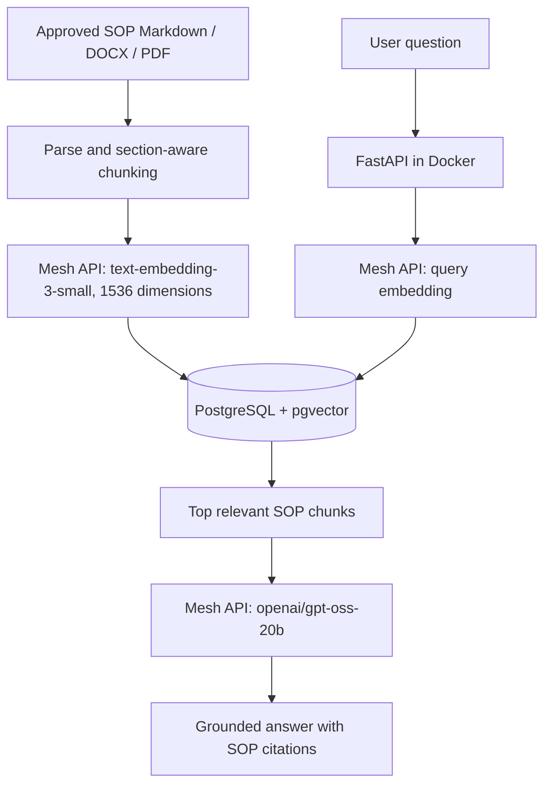

# Primark Oracle DBA SOP Assistant — Mesh API + PostgreSQL (pgvector)

A FastAPI RAG assistant for Oracle DBA troubleshooting SOPs. Mesh API provides both embedding and answer-generation calls through its OpenAI-compatible API. PostgreSQL with the `pgvector` extension stores vector embeddings and SOP metadata. Docker Compose runs the API and PostgreSQL vector database locally.

## Architecture



## Stack

- Python 3.12, FastAPI
- Mesh API base URL: `https://api.meshapi.ai/v1`
- LLM generation and rewrite model: `openai/gpt-oss-20b`
- Embedding model: `text-embedding-3-small` (1536 dimensions by default)
- Vector DB: PostgreSQL with `pgvector` extension (`HNSW` cosine distance indexing)
- Docker / Docker Compose (`pgvector/pgvector:pg16`)
- Optional Amazon Bedrock Guardrails; generation and embeddings call Mesh API

## 1. Configure Mesh API and PostgreSQL

Create an API key from [Mesh API](https://app.meshapi.ai) → **API Keys**. Do not paste the key into chat or commit it to Git.

In PowerShell, from the project root:

```powershell
Copy-Item .env.example .env
notepad .env
```

Set `MESH_API_KEY` to your key and configure database parameters:

```env
MESH_BASE_URL=https://api.meshapi.ai/v1
GENERATION_MODEL_ID=openai/gpt-oss-20b
REWRITE_MODEL_ID=openai/gpt-oss-20b
EMBEDDING_MODEL_NAME=text-embedding-3-small
EMBEDDING_DIMENSIONS=1536

# PostgreSQL / pgvector settings
POSTGRES_HOST=localhost
POSTGRES_PORT=5433
POSTGRES_DB=primark_sop
POSTGRES_USER=postgres
POSTGRES_PASSWORD=postgres
POSTGRES_SSLMODE=disable
POSTGRES_TABLE=sop_chunks
```

## 2. Test Mesh API and PostgreSQL

```powershell
python -m venv .venv
.\.venv\Scripts\Activate.ps1
python -m pip install -r backend\requirements.txt
python scripts\verify_mesh.py
```

This verifies that Mesh API embeddings, LLM generation, and the PostgreSQL connection are working.

To run a standalone round-trip test against a running PostgreSQL/pgvector instance:

```powershell
python scripts\verify_postgres.py
```

## 3. Run with Docker Compose

Docker Desktop must be running.

```powershell
docker compose up --build -d postgres api
docker compose --profile ingest run --rm ingest
```

Open `http://127.0.0.1:8080`.
- Health check: `http://127.0.0.1:8080/healthz`
- Readiness (vector DB check): `http://127.0.0.1:8080/readyz`
- API documentation: `http://127.0.0.1:8080/docs`

To check API logs:

```powershell
docker compose logs -f api
```

To stop containers without deleting indexed data:

```powershell
docker compose down
```

## 4. Ingestion

To ingest SOPs directly using Python (with PostgreSQL running locally or in Docker):

```powershell
$env:PYTHONPATH = (Resolve-Path .\backend).Path
python -m app.ingestion --local-dir .\sops\Primark
```

Flags:
- `--force`: Force re-indexing even if file hash is unchanged.
- `--recreate-table`: Drop and recreate the vector table.

## 5. Tests and Retrieval Evaluation Benchmark

Make sure the PostgreSQL container is running (`docker compose up -d postgres`) before evaluating retrieval against indexed SOPs.

### Run Retrieval Evaluation across all cutoffs (k = 1, 3, 5, 10)
From the repository root in PowerShell:
```powershell
$env:PYTHONPATH="backend"
.\.venv\Scripts\python.exe -m eval.run_eval --eval-all-k
```

Or from the `backend/` directory:
```powershell
cd backend
python -m eval.run_eval --eval-all-k
```

### Useful Evaluation Options
- `--eval-all-k`: Evaluates $k \in \{1, 3, 5, 10\}$ and prints the comparative table (`Hit@k`, `Recall@k`, `Precision@k`, `MRR@k`, `MAP@k`).
- `--k <int>`: Evaluate a specific cutoff (e.g. `--k 5`).
- `--verbose`: Print detailed per-query retrieved SOP IDs, similarities, and misses.
- `--dataset <path>`: Evaluate against a custom JSONL dataset (defaults to `backend/eval/golden_set.jsonl`).

### Run Unit Tests & Linting
```powershell
cd backend
pytest -q
ruff check .
```

## Security notes

- Keep `.env` out of Git (`.gitignore` excludes it).
- Rotate your Mesh API key immediately if exposed.
- Approve SOPs with the responsible DBA/service owner before operational use.
- Answers are advisory troubleshooting recommendations and cite approved SOPs.
